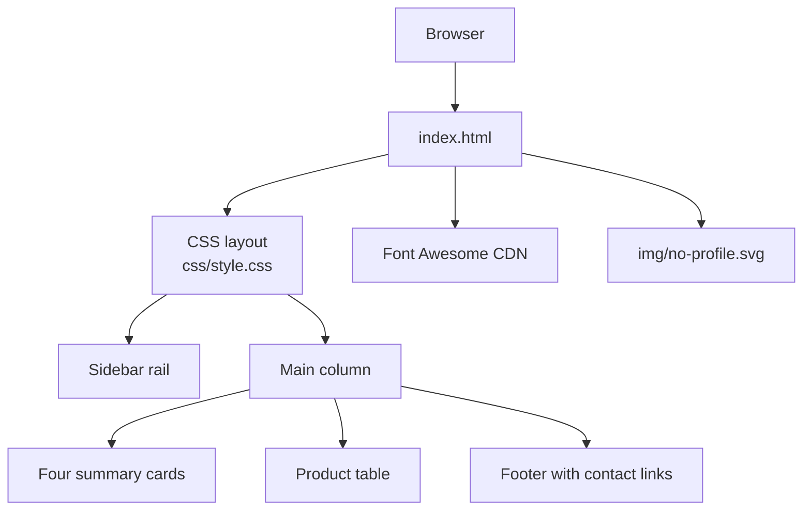
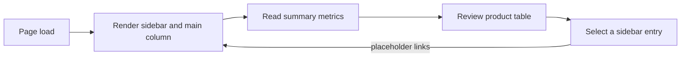

<div align="center">


<p><strong>A static administrator interface with a sidebar, summary metrics, and a product table, built with plain HTML and CSS.</strong></p>

</div>

<div align="center">

<a href="https://github.com/mohammed-laabidi/dashboard-admin"></a>
<a href="https://github.com/mohammed-laabidi/dashboard-admin/fork"></a>
<a href="https://github.com/mohammed-laabidi/dashboard-admin/issues"></a>


</div>

<div align="center">

<a href="https://mohammed-laabidi.github.io/dashboard-admin/"><strong>Live Demo</strong></a>
&nbsp;&nbsp;|&nbsp;&nbsp;
<a href="https://github.com/mohammed-laabidi/dashboard-admin">Repository</a>

</div>

## Overview

Admin Dashboard is a markup and styling exercise that reproduces the layout of a back-office application. It presents a vertical navigation rail with a user block and eight entries, a main column with four summary cards (users, posts, products, revenue), and a product table showing price and stock count.

The project contains no JavaScript and no data layer. The figures in the cards and the three product rows are hard-coded in the document, which makes the repository a reusable visual scaffold rather than a working administration system. Values and labels are replaced directly in the HTML when the page is adapted.

The interface relies on the Font Awesome icon set for navigation and card icons and uses CSS Grid and Flexbox for placement.

## Features

<table>
<tr>
<td width="50%" valign="top">


### Sidebar navigation

A persistent rail groups the profile block and the sections: dashboard, clients, products, charts, posts, favourite, setting, and log out.

</td>
<td width="50%" valign="top">


### Summary cards

Four cards report users, posts, products, and revenue with an icon, a label, and a value.

</td>
</tr>
<tr>
<td width="50%" valign="top">


### Product table

A compact table lists product, price, and count for each row with dedicated styling for the numeric columns.

</td>
<td width="50%" valign="top">


### Responsive layout

Three media queries rearrange the sidebar and main column for narrower viewports.

</td>
</tr>
<tr>
<td width="50%" valign="top">


### Avatar placeholder

A local SVG avatar is used when no profile photo is available.

</td>
<td width="50%" valign="top">


### Icon system

Font Awesome 6 supplies the icons for navigation, cards, and section headers through a CDN stylesheet.

</td>
</tr>
</table>

## Technology Stack

<div align="center">


</div>

| Technology | Purpose |
| --- | --- |
| HTML5 | Sidebar, metric cards, table, and footer markup |
| CSS3 | Grid and Flexbox layout, cards, table, and media queries |
| Font Awesome 6 | Icons loaded from a CDN |
| GitHub Pages | Static hosting of the live demo |

## Architecture

The page is a single static document. There are no scripts, network requests to an API, or persisted data.



All content is authored in the HTML file, so changing a metric or a product row is a direct edit of the markup.

## Application Flow



The sidebar entries and the footer actions are the only interactive elements. Section links use `#` targets and therefore stay on the same page.

## Project Structure

```text
dashboard-admin/
├── index.html
├── css/
│   └── style.css
├── img/
│   └── no-profile.svg
└── README.md
```

## Getting Started

### Prerequisites

A modern browser. No dependencies or build step are required.

### Installation

```bash
git clone https://github.com/mohammed-laabidi/dashboard-admin.git
cd dashboard-admin
```

Open `index.html` in a browser, or serve the folder locally:

```bash
python -m http.server 8000
```

## Usage

- Review the four summary cards to see the layout of metric tiles.
- Replace the numbers in `index.html` to display real values.
- Extend the table with additional rows by copying an existing `tr` block.
- Use the sidebar to inspect the styling of the active and hover states.

## Deployment

The live demo is hosted on GitHub Pages from the repository root. Because the output is static, the same folder can be served by any web server or static host.

## Author

<table>
<tr>
<td valign="top">

**Mohammed Laabidi**

<a href="https://github.com/mohammed-laabidi"> GitHub</a>
&nbsp;&nbsp;
<a href="https://www.linkedin.com/in/mohammed-laabidi-793a40436"> LinkedIn</a>
&nbsp;&nbsp;
<a href="mailto:mohammed-laabidi@gmail.com"> Email</a>

</td>
</tr>
</table>

---

If this project is useful to you, consider giving the repository a star.
